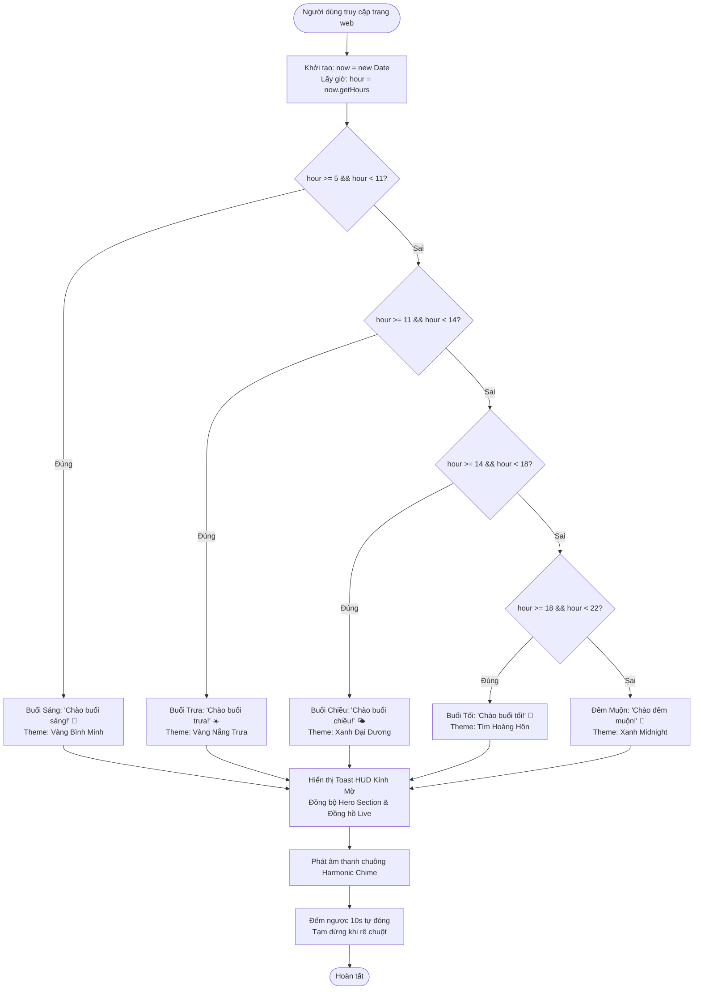

# BÁO CÁO GIẢI THÍCH LOGIC - TUẦN 8: "THE LOGIC PUZZLE"
**Học phần:** Phát triển Ứng dụng Web (CT113)  
**Dự án:** Portfolio Cá Nhân Giữa Kỳ  
**Sinh viên thực hiện:** Nguyễn Lê Hữu Tài — **MSSV:** 125001425  
**File mã nguồn chính:** [`htai.js`](./htai.js), [`htai.html`](./htai.html), [`htai.css`](./htai.css)

---

## 1. MỤC TIÊU THỬ THÁCH
Theo yêu cầu thử thách tuần 8:
> *"Hãy tích hợp một đoạn mã JS vào trang dự án giữa kỳ của nhóm. Cụ thể: Khi người dùng vào trang web, hãy hiện một thông báo chào mừng theo thời gian thực (Ví dụ: Nếu là buổi sáng thì hiện 'Chào buổi sáng!', buổi chiều hiện 'Chào buổi chiều!')."*
>
> **Yêu cầu nộp:** Link GitHub và file `logic_explanation.md` giải thích cách sử dụng hàm `new Date().getHours()` để lấy thời gian.

Dự án đã nâng cấp thử thách này lên chuẩn **cao cấp và chuyên nghiệp nhất**, không chỉ dừng lại ở hộp thoại `alert()` đơn điệu mà xây dựng thành một **Hệ thống Toast HUD Thông Minh (Smart Real-time Greeting System)** với giao diện Glassmorphism đẳng cấp.

---

## 2. NGUYÊN LÝ HOẠT ĐỘNG CỦA HÀM `new Date().getHours()`

### 2.1. Đối tượng `Date` trong JavaScript
Trong ngôn ngữ JavaScript, `Date` là đối tượng tích hợp sẵn dùng để quản lý ngày, tháng, năm và thời gian. Khi khởi tạo:
```javascript
const now = new Date();
```
Trình duyệt sẽ tạo ra một đối tượng đại diện cho thời điểm hiện tại chính xác đến từng mili-giây, dựa trên đồng hồ hệ thống của thiết bị người dùng.

### 2.2. Phương thức `getHours()`
- **Cú pháp:** `now.getHours()`
- **Giá trị trả về:** Một số nguyên (integer) có giá trị nằm trong khoảng từ **`0` đến `23`**.
  - `0`: 00h đêm (12:00 AM)
  - `1`: 01h sáng
  - `12`: 12h trưa
  - `18`: 18h tối (06:00 PM)
  - `23`: 23h đêm (11:00 PM)
- **Đặc tính múi giờ:** `getHours()` trả về giờ theo **múi giờ địa phương (Local Timezone)** của máy khách (Client), hoàn toàn phù hợp để chào người dùng theo thời gian thực tại nơi họ đang sinh sống.

---

## 3. BẢNG PHÂN CHIA CÁC KHUNG GIỜ TRONG NGÀY

Để tạo cảm giác thân thiện, tinh tế và văn minh, hệ thống chia 24 giờ thành **5 buổi** tự nhiên:

| Khung Giờ (24h) | Biểu thức Logic Điều Kiện | Buổi | Lời Chào Tương Ứng | Biểu Tượng & Theme |
| :---: | :--- | :---: | :--- | :---: |
| **05:00 - 10:59** | `hour >= 5 && hour < 11` | Buổi Sáng | **"Chào buổi sáng!"** | 🌅 Vàng Bình Minh (`#f59e0b`) |
| **11:00 - 13:59** | `hour >= 11 && hour < 14` | Buổi Trưa | **"Chào buổi trưa!"** | ☀️ Vàng Nắng Ấm (`#eab308`) |
| **14:00 - 17:59** | `hour >= 14 && hour < 18` | Buổi Chiều | **"Chào buổi chiều!"** | 🌤️ Xanh Đại Dương (`#06b6d4`) |
| **18:00 - 21:59** | `hour >= 18 && hour < 22` | Buổi Tối | **"Chào buổi tối!"** | 🌆 Tím Hoàng Hôn (`#8b5cf6`) |
| **22:00 - 04:59** | `hour >= 22 \|\| hour < 5` | Đêm Muộn | **"Chào đêm muộn!"** | 🌙 Xanh Midnight (`#3b82f6`) |

---

## 4. SƠ ĐỒ THUẬT TOÁN (FLOWCHART)



---

## 5. TRÍCH ĐOẠN MÃ NGUỒN CỐT LÕI (FILE `htai.js`)

```javascript
/**
 * Hàm xác định thông điệp chào mừng theo thời gian
 * @param {number|null} customHour - Giờ mô phỏng hoặc null nếu dùng thời gian thực
 */
function getGreetingData(customHour = null) {
    // 1. Lấy thời gian thực thông qua new Date().getHours()
    const now = new Date();
    const hour = (customHour !== null) ? customHour : now.getHours();

    // 2. Cấu trúc rẽ nhánh điều kiện logic
    if (hour >= 5 && hour < 11) {
        return {
            periodName: 'Buổi Sáng',
            greeting: 'Chào buổi sáng!',
            emoji: '🌅',
            iconClass: 'fa-solid fa-sun',
            themeClass: 'theme-morning',
            message: 'Chúc bạn một ngày mới tràn đầy năng lượng, sảng khoái và làm việc thật hiệu quả!'
        };
    } else if (hour >= 11 && hour < 14) {
        return {
            periodName: 'Buổi Trưa',
            greeting: 'Chào buổi trưa!',
            emoji: '☀️',
            iconClass: 'fa-solid fa-cloud-sun',
            themeClass: 'theme-noon',
            message: 'Đã đến giờ nghỉ ngơi giữa ngày! Chúc bạn có một bữa trưa ngon miệng và nạp lại năng lượng.'
        };
    } else if (hour >= 14 && hour < 18) {
        return {
            periodName: 'Buổi Chiều',
            greeting: 'Chào buổi chiều!',
            emoji: '🌤️',
            iconClass: 'fa-solid fa-sun-plant-wilt',
            themeClass: 'theme-afternoon',
            message: 'Chúc bạn một buổi chiều làm việc tập trung cao độ, bứt phá và gặt hái nhiều kết quả tốt đẹp!'
        };
    } else if (hour >= 18 && hour < 22) {
        return {
            periodName: 'Buổi Tối',
            greeting: 'Chào buổi tối!',
            emoji: '🌆',
            iconClass: 'fa-solid fa-cloud-moon',
            themeClass: 'theme-evening',
            message: 'Chúc bạn một buổi tối ấm áp, thư thái và bình yên bên người thân sau ngày dài học tập!'
        };
    } else {
        return {
            periodName: 'Đêm Muộn',
            greeting: 'Chào đêm muộn!',
            emoji: '🌙',
            iconClass: 'fa-solid fa-moon',
            themeClass: 'theme-night',
            message: 'Chào mừng bạn ghé thăm Portfolio của Hữu Tài! Trời đã về khuya, đừng thức quá muộn nhé.'
        };
    }
}
```

---

## 6. CÁC ĐIỂM NỔI BẬT VÀ CAO CẤP CỦA HỆ THỐNG

1. **Giao diện Glassmorphism & Spring Animation**:
   - Thẻ thông báo Toast xuất hiện ở góc trên bên phải với hiệu ứng nảy mượt mà (`cubic-bezier(0.16, 1, 0.3, 1)`).
   - Nền kính mờ làm mờ hậu cảnh (`backdrop-filter: blur(20px)`), viền phát quang ánh sáng (Ambient Glow) tự động chuyển màu sắc theo 5 buổi.

2. **Bộ mô phỏng mốc giờ (Time Simulator - Tính năng đắt giá cho Giảng viên)**:
   - Trong quá trình chấm bài, nếu Giảng viên chấm vào buổi sáng thì không thể thấy được giao diện của buổi tối hay buổi chiều nếu chỉ dựa vào đồng hồ máy tính.
   - Hệ thống tích hợp sẵn các nút bấm kiểm thử: `[Tự động]`, `[08h Sáng]`, `[12h Trưa]`, `[16h Chiều]`, `[20h Tối]`, `[23h Đêm]`.
   - Giảng viên chỉ cần click là giao diện, lời chào, màu theme và icon đổi ngay lập tức để kiểm chứng logic.

3. **Âm thanh Harmonic Chime (Web Audio API)**:
   - Sử dụng bộ tạo dao động âm tần số toán học trong JS thuần (Sine wave 659Hz & 987Hz), không phụ thuộc vào file MP3 ngoài, không gây lag và có nút tắt/bật âm thanh ghi nhớ vào `localStorage`.

4. **Đồng hồ thời gian thực (Live Digital Clock)**:
   - Hiển thị Giờ : Phút : Giây cập nhật liên tục mỗi giây cùng thứ, ngày, tháng tiếng Việt chuẩn.

5. **Đồng bộ hóa vào Hero Section**:
   - Ngay tại đầu trang Portfolio, thông điệp chào mừng và đồng hồ số cũng được nhúng trực tiếp vào huy hiệu (`hero-greeting-badge`), tạo sự đồng nhất cao cấp cho website.

6. **Thu gọn & Mở lại linh hoạt**:
   - Khi đóng Toast hoặc khi hết 10 giây tự đóng, Toast thu nhỏ thành nút bấm nổi `[ 🔔 Chào Mừng ]` ở góc màn hình để người dùng có thể xem lại bất kỳ lúc nào.

---

## 7. HƯỚNG DẪN NỘP BÀI GITHUB

Để nộp bài tập theo yêu cầu, sinh viên thực hiện các bước sau trong terminal Git:

```bash
# 1. Thêm toàn bộ các file mới và thay đổi
git add htai.html htai.css htai.js logic_explanation.md

# 2. Tạo commit ghi rõ nội dung
git commit -m "feat: hoàn thành thử thách Tuần 8 - The Logic Puzzle với Smart Realtime Greeting System"

# 3. Đẩy lên repository GitHub của nhóm
git push origin main
```

**Link GitHub dự án:** `https://github.com/<tai-khoan-github>/<ten-repository-nhom>`  
*(Sinh viên thay thế đường dẫn GitHub thực tế của nhóm vào vị trí trên khi nộp bài).*
